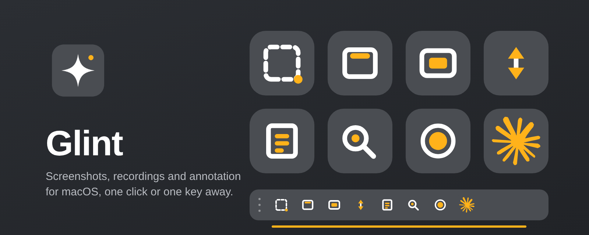
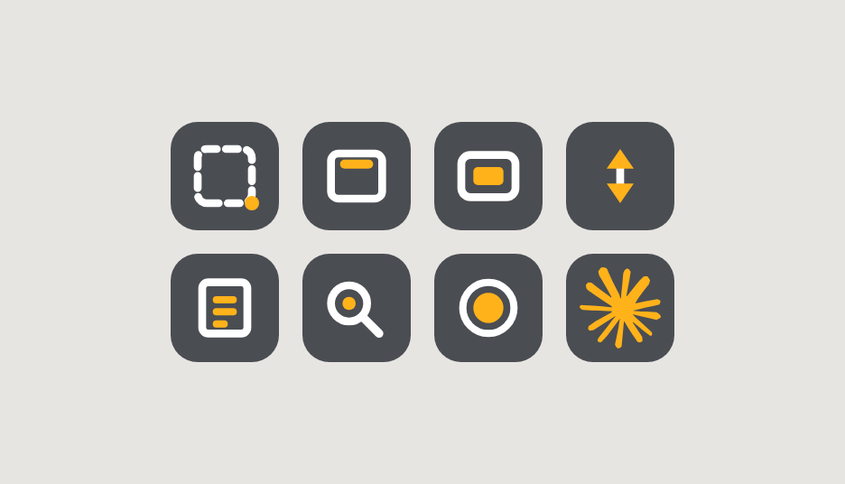
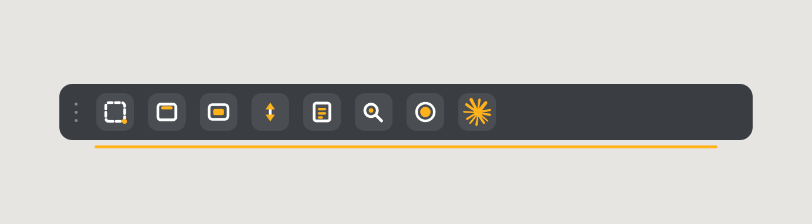
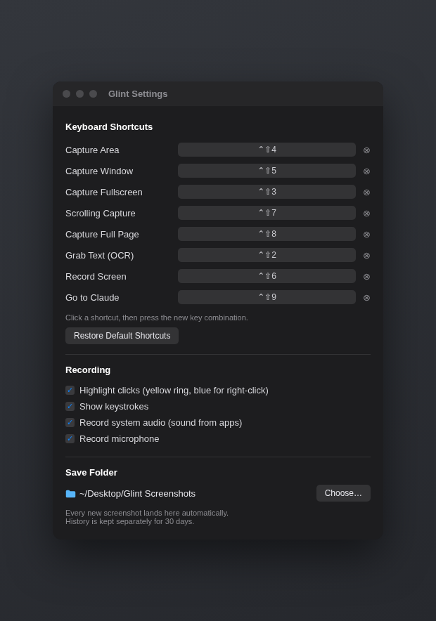
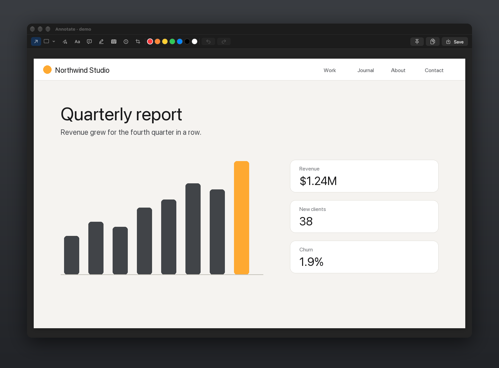

<p align="center"></p>

<h1 align="center">Glint</h1>

<p align="center">
A native macOS screenshot and screen recording tool that lives in the menu bar.<br>
Capture an area, a window, a whole page or a video, then mark it up and drop it anywhere.
</p>

<p align="center"><sub>Swift, AppKit and SwiftUI · ScreenCaptureKit, Vision, AVFoundation · no third-party dependencies · macOS 15+</sub></p>

## Install

```bash
npx github:barkimchi/glint-app
```

That downloads the latest release, puts `Glint.app` in `~/Applications` and opens it. Glint then checks for updates on its own and offers to install them; the menu also has Check for Updates…. (Releases before v0.1.2 don't self-update: run the `npx` line once more to get onto the updater.)

You need Node for `npx`, nothing else. On first launch macOS asks for Screen Recording access; Glint shows a button that opens the right System Settings pane. Release builds are ad hoc signed, so macOS may ask for that access again after an update.

> "Glint" is a working name and has not been vetted yet.

## What it does

| | |
|---|---|
| **Capture an area** | The screen freezes, you drag a rectangle. Menus and hover states stay exactly as they were. |
| **Capture a window** | Click any window. The shadow comes with it. |
| **Capture fullscreen** | The display under the pointer. |
| **Scrolling capture** | Drag over a scrollable area, then scroll it. Glint stitches one tall image with no seams. |
| **Capture a full page** | Click a window and Glint scrolls it top to bottom for you, keeping toolbars and sticky headers once. |
| **Grab text** | Drag over anything on screen and the text lands on your clipboard. Reads QR codes too. |
| **Record the screen** | An area or the whole display, to MP4, with optional click rings, keystrokes, system audio and microphone. One click turns it into a GIF. |
| **Go to Claude** | Jumps straight to the Claude desktop app. |

Every one of these has a keyboard shortcut, a button on the edge widget and a button in the middle-click popup.

## Three ways to trigger a capture

### 1. The middle-click popup

Press the middle mouse button anywhere and the actions appear under your pointer. Hover a button to see its name, click to fire it, click elsewhere to dismiss.

<p align="center"></p>
<p align="center"><sub>Rendering of the popup with the current buttons.</sub></p>

### 2. The edge widget

A thin tab that hugs the border of your screen. Hover and it opens into the same buttons; click the tab to pin it open. Drag the grip to park it on any edge of any display.

<p align="center"></p>
<p align="center"><sub>Rendering of the edge widget with the current buttons.</sub></p>

### 3. Keyboard shortcuts

| Default | Action |
|---|---|
| ⌃⇧4 | Capture area |
| ⌃⇧5 | Capture window |
| ⌃⇧3 | Capture fullscreen |
| ⌃⇧7 | Scrolling capture |
| ⌃⇧8 | Capture full page |
| ⌃⇧2 | Grab text (OCR) |
| ⌃⇧6 | Start or stop a recording |
| ⌃⇧9 | Go to Claude |

Esc cancels any selection. Change or clear any shortcut in Settings: click it and press the new keys.

<p align="center"></p>
<p align="center"><sub>Rendering; new installs default to Desktop/Glint Screenshots.</sub></p>

## After the capture

### Annotate

Arrows, boxes, ellipses, lines, free draw, text, text blocks, highlight, pixelate, numbered steps and crop, in seven colours, with undo and redo. Copy with ⇧⌘C, save with ⌘S, or pin the result.

<p align="center"></p>

### Quick access thumbnail

Every screenshot is saved straight to your save folder (Desktop/Glint Screenshots by default) and shows up as a thumbnail in the bottom-left corner. Drag it into any app, double-click to open it, or hover for Copy, Save, Annotate and Pin. Videos get Copy, Save, GIF and Show in Finder. Thumbnails dismiss themselves after 30 seconds unless you pin them; hovering pauses the countdown.

### Pins

Pin a screenshot and it floats above every window, docked under the edge widget. It follows the widget wherever you park it. Drag a pin to move it by hand, scroll to fade, right-click for Copy, Annotate, opacity and Lock (click-through). Double-click or Esc closes it.

### History

Everything is kept for 30 days in `~/Library/Application Support/Glint/History` and browsable from the menu. Screenshots also land in your save folder the moment you take them; Save copies videos and editor exports there too.

## Details worth knowing

- **Full-page capture** works out which rows actually scroll, so fixed toolbars and footers appear once. A fixed sidebar that has content in it will repeat down the image. The cap is 40,000 px.
- **Scrolling capture** lets you scroll by hand at any speed, and warns you if it loses track. Auto-scroll does it for you and stops at the end.
- **Recording** is H.264 MP4 at 30 fps. Click rings are yellow for left and blue for right. The keystroke pill never shows password fields, because macOS blocks them. System audio and microphone are mixed into one AAC track.
- **Permissions**: Screen Recording for everything. Accessibility for full-page capture, auto-scroll, keystroke display and the middle-click popup. Microphone only if you turn it on.
- **Middle click**: while the popup is switched on, Glint takes the middle button system-wide. Turn it off from the menu bar (Middle-Click Action Ring) to get it back.

## Build from source

Needs Xcode and [XcodeGen](https://github.com/yonaskolb/XcodeGen).

```bash
xcodegen && xcodebuild -project Glint.xcodeproj -scheme Glint -derivedDataPath build build
```

The app lands in `build/Build/Products/Debug/Glint.app`. By default it is ad hoc signed, so no Apple developer account is needed. To sign with your own certificate, which keeps the Screen Recording grant across rebuilds, put it in `Config/Local.xcconfig` (see `Config/Signing.xcconfig`).

Useful launch flags on `Glint.app/Contents/MacOS/Glint`:

| Flag | What it does |
|---|---|
| `--selftest <dir>` | Runs capture, crop, every annotation tool, OCR, a short recording, GIF export and the stitching tests headlessly |
| `--edit <png>` | Opens the editor on an image |
| `--settings`, `--widget-open`, `--ring-open` | Open that surface at launch |
| `--shots <dir>` | Renders every open Glint window to a PNG (how the images above were made) |

### Cutting a release

```bash
xcodebuild -project Glint.xcodeproj -scheme Glint -configuration Release -derivedDataPath build build
```

```bash
ditto -c -k --keepParent build/Build/Products/Release/Glint.app build/Glint.zip
```

```bash
gh release create v0.1.1 build/Glint.zip --title "Glint 0.1.1"
```

The installer always pulls `Glint.zip` from the latest release.

## Status

Checked by self-test and by rendering the app's own windows: capture, crop, all annotation tools, OCR, recording, GIF export, scroll stitching, full-page band detection, and the look of the widget, popup, settings and editor. The one-line install was run end to end on 2026-11-13.

Not yet checked by hand: a real full-page capture in a browser, the middle-click trigger, hover name tags, dragging and pinning the widget, pin docking under the widget, the 30-second thumbnail dismiss, multi-monitor, Retina scaling, and the first-run permission prompt.

## Roadmap

- Sticky footers and content sidebars in scrolling and full-page capture
- Moving and editing annotations after they are placed
- Background and padding for window shots
- Hide desktop icons while capturing
- Custom app opens: choose which app the quick-open action launches, not just Claude
- Shortcut selection in the middle-click popup (scope to settle: picking which actions appear, remapping keys from the popup, or both)
- Clearer first run: permissions and where screenshots are saved
- Name vetting, then a rename
