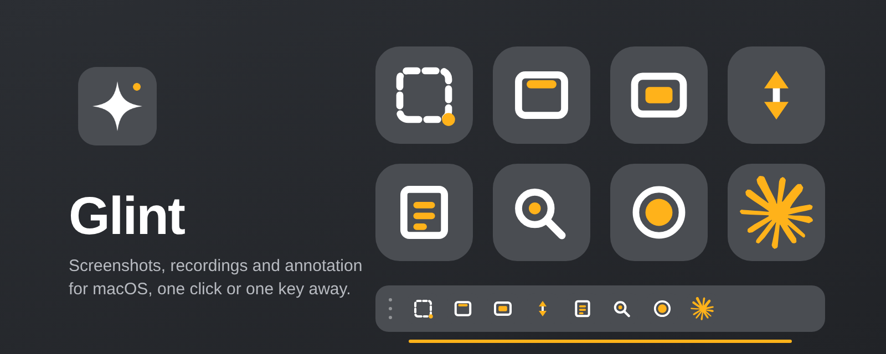
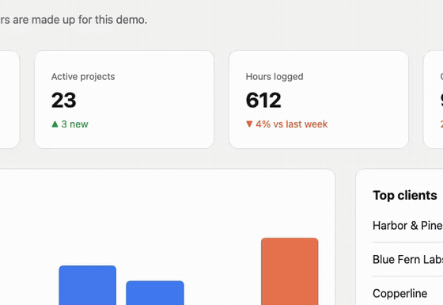
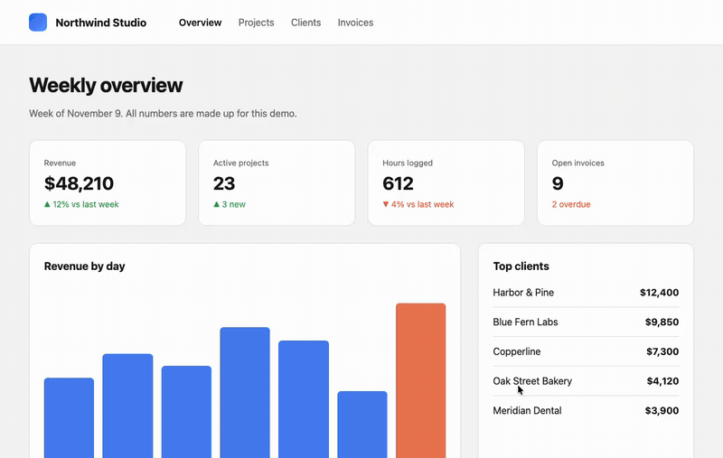
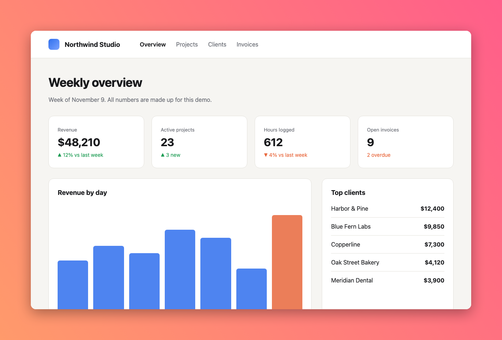
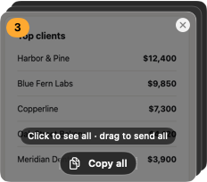
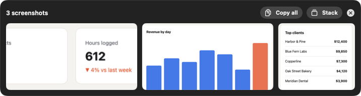
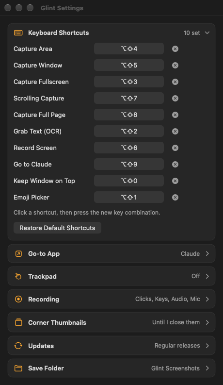

<h3 align="center">Screenshots, recordings and markup for macOS. One middle-click away.</h3>

  

  
  
  
  

Or from the terminal: <code>npx github:barkimchi/glint-app</code>

 

## ⚡ Capture anything

The screen freezes, you drag, it's saved. Menus and hover states stay exactly where they were.

<table>
  <tr>
    <td><b>Area</b> · <b>Window</b> · <b>Fullscreen</b></td>
    <td>The classics. Window shots keep their shadow.</td>
  </tr>
  <tr>
    <td><b>Scrolling</b> · <b>Full page</b></td>
    <td>Glint scrolls for you and stitches one tall, seamless image.</td>
  </tr>
  <tr>
    <td><b>Grab text</b></td>
    <td>Drag over anything and the text lands on your clipboard. QR codes too.</td>
  </tr>
  <tr>
    <td><b>Record</b></td>
    <td>MP4 with click rings, keystrokes and audio. One click makes it a GIF.</td>
  </tr>
</table>

 

## 🎛️ Your popup, your way

<table>
  <tr>
    <td width="50%"></td>
    <td width="50%">
      <b>Middle-click anywhere</b> and your actions appear under the pointer.  
      <b>Long-press</b> and they wiggle: drag to reorder, tap ⊖ to remove, tap ＋ to add actions or <b>any app on your Mac</b>.  
      Prefer the keyboard? Every action has a shortcut. Prefer the mouse? A slim widget hugs any screen edge.
    </td>
  </tr>
</table>

 

## ✏️ Mark it up, then change your mind

Arrows, boxes, highlights, numbered steps, text, pixelate and crop. Every mark stays editable: select it to move, resize, recolour or delete.

 

## 🖼️ Make it presentable

<table>
  <tr>
    <td width="55%"></td>
    <td width="45%">
      One click puts your shot on a gradient with padding, rounded corners and a soft shadow.  
      Six backgrounds, adjustable padding. Ready for a post, a deck or the docs.
    </td>
  </tr>
</table>

 

## 🪄 New in 0.2.3: the screenshot pile

<table>
  <tr>
    <td width="34%" align="center"></td>
    <td width="66%">
      Take a few shots in a row and they <b>stack in the corner</b>, newest on top.  
      <b>Drag the pile</b> into Claude, Slack or Finder and they all go. <b>Copy all</b> pastes every one.  
      <b>Click it</b> to lay them out and drag or right-click just one.
    </td>
  </tr>
</table>

 

## 📌 And the small things

**Quick access** · every shot waits in the corner: drag it anywhere, or hover for Copy, Annotate and Pin. 
**Keep on top** · press ⌃⇧0 and click any window to lock it above everything, even other apps. 
**Trackpad edges** · slide one finger down the left edge for volume, the right edge for brightness; hold a top corner to run an action. 
**Pins** · float a screenshot above every window, fade it, or make it click-through. 
**History** · 30 days of captures, one click from the menu bar. 
**Welcome tour** · a quick guided start on first launch, and a What's New card after each update. 
**Betas** · turn on Get beta builds in Settings and new features arrive through Check for Updates first. 
**Private** · no account, no cloud. Everything stays on your Mac.

 

<b>Keyboard shortcuts</b>

 

| Shortcut | Action |
|---|---|
| ⌃⇧4 | Capture area |
| ⌃⇧5 | Capture window |
| ⌃⇧3 | Capture fullscreen |
| ⌃⇧7 | Scrolling capture |
| ⌃⇧8 | Capture full page |
| ⌃⇧2 | Grab text |
| ⌃⇧6 | Start or stop a recording |
| ⌃⇧9 | Go to Claude (or the app you pick) |
| ⌃⇧0 | Keep a window on top |

Esc cancels any selection. Change any shortcut in Settings.

<b>Install, updates and permissions</b>

 

- **Install**: unzip, drag `Glint.app` to Applications, open it. Releases are signed and notarized by Apple.
- **Updates**: Glint checks on its own and verifies each update before installing. The menu has Check for Updates too.
- **Permissions**: Screen Recording for everything. Accessibility for full-page and scrolling capture, keystrokes and the middle-click popup. Microphone only if you turn it on. Trackpad edges need nothing extra.
- **Middle click**: while the popup is on, Glint takes the middle button system-wide. Turn it off from the menu bar.
- **Files**: screenshots save to Desktop/Glint Screenshots by default. History lives in `~/Library/Application Support/Glint/History`.

<b>Under the hood</b>

 

- Swift, AppKit and SwiftUI on ScreenCaptureKit, Vision and AVFoundation. No third-party dependencies apart from Sparkle for updates.
- Full-page capture works out which rows actually scroll, so fixed toolbars appear once. The cap is 40,000 px.
- Recordings are H.264 MP4 at 30 fps; system audio and microphone mix into one AAC track. Password fields never show in the keystroke pill.
- Building, test flags, recording these GIFs and cutting a release: [docs/DEVELOPING.md](docs/DEVELOPING.md).

<b>Coming next</b>

 

- Sticky footers and content sidebars in scrolling and full-page capture
- Hide desktop icons while capturing

 

Made by <a href="https://github.com/barkimchi">Bar Kimchi</a>

